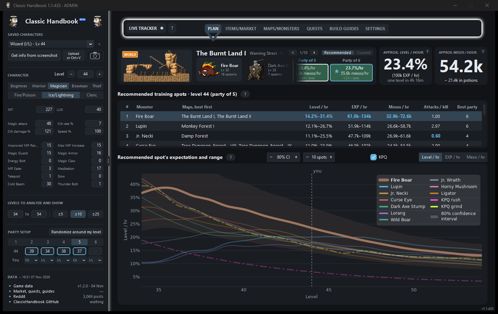
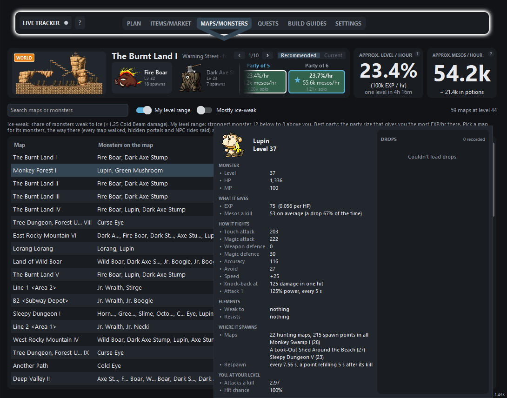
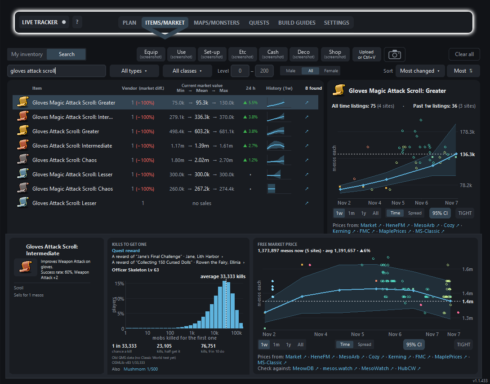
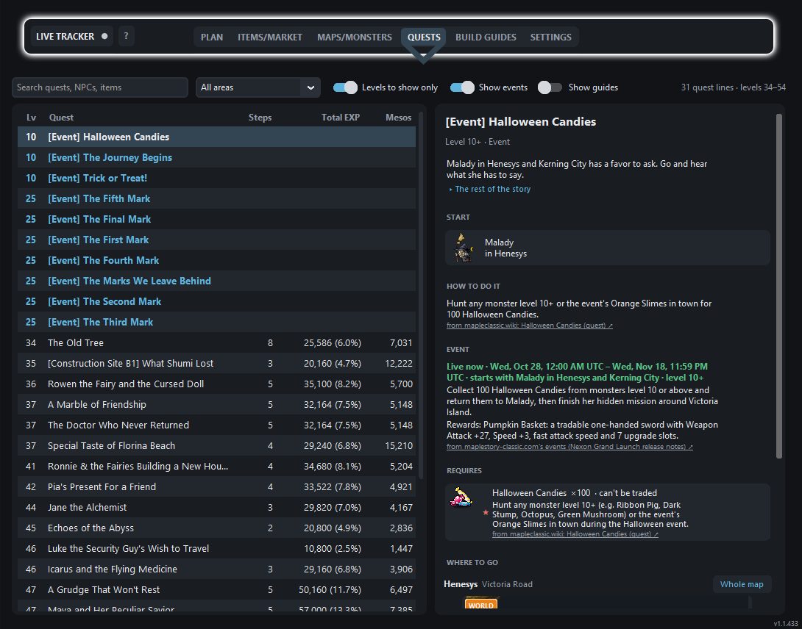
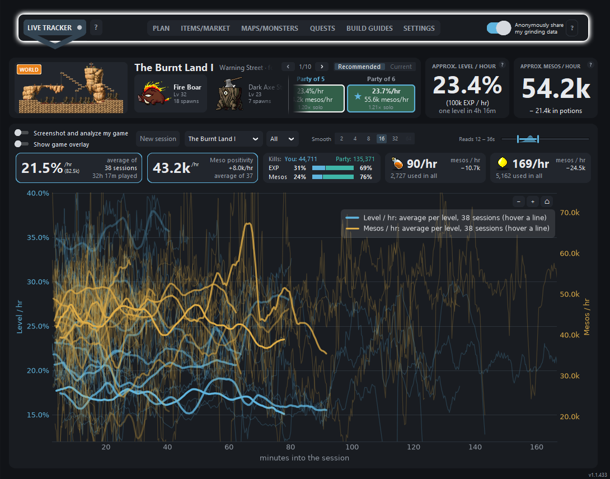

# Classic Handbook

Where to train in **MapleStory Classic World**, for every class and level from 1 to 100, solo or in a party.

**[Open it in your browser](https://nairck.github.io/ClassicHandbook/)**

The first time you open it, a short welcome guide walks through the main tabs, the live tracker and the overlay (Settings › Theme shows it again).

## Plan

Your class, stats, level and party on the left; the best spots for them on the right, ranked by level, EXP or mesos per hour, and how each one holds up as you level.

The **Party** tab shows what each party size earns you on those maps, by the game's own EXP-sharing rules.

## Maps and monsters

Every hunting map with its layout, portals and the way into hidden maps. Hover a monster for its full card: stats, where it spawns and everything it drops.

## Items

Search any item for its drop odds, who drops it, and its price history from several market sites, with the shops selling it now: who's selling, where (channel and Free Market room), how long ago and how each price compares with the market.

The price chart shows a week, a month, a year or everything, either day by day (the average with its 95% confidence band, and every listing and sale a site has shown as a dot in that site's colour) or as the range's sales spread over prices. **TIGHT**, the default, zooms in on the price line and its band, leaving far-off listings off the edge; **ALL** fits every listing and sale in. Hover anything on it for the details.

Classic World's cash items are in too: 2,905 Deco cosmetics (weapon covers included), Cash-tab items and pets, named and priced from the market sites like any other item.

## Quests

Every quest line and event at your level, with its steps, rewards and where to find each item it asks for.

**Guides** sit beside the quests: 1st and 2nd job advancement for every class, bringing a pet back to life, the Kerning City Party Quest, and the answers to every NPC quiz in the game (Rain's Maple Quiz, Cloto's questions and more), taken from Classic World's own game files where they can be, each with its sources and whatever isn't confirmed yet said plainly. Events and guides are a switch each; opening a quest, guide or map from anywhere else turns on just what it needs to be listed.

## Build guides

Every class's builds level by level: where the AP and SP go, from the guides players follow. Pick any job and class from the two menus beside the title; it starts on yours.

## Live tracker (Windows app, COMING SOON)

Reads your EXP, mesos and potions from pictures of the game window and shows your real rates beside the plan. Each picture is the game window's own, asked of Windows the way Discord's screen sharing takes a window, so another window over the game doesn't get in the way (where Windows can't do that, it copies the screen instead). It comes with an optional overlay on the game: your kills and your share of the party's (counted from the game's EXP messages), each potion you drink and what it restored, and the items you pick up. Reading a screen takes about half a second. You choose how often it reads, from at most every 5 seconds to as rarely as every 10 minutes, each read at a random moment; your setting is kept, and each start moves its middle by up to 15 seconds at random. The Items tab reads all six inventory tabs (Equip, Use, Set-up, Etc, Cash and Deco) and player shops from a screenshot.

Your stats, skills and party come from the same screenshots: the stat and skill windows when they're open, and your party from the Party window or the party's HP list (whoever's on your map; someone leaving is taken out, and who's who is remembered through a restart). With the tracker off, Get info from screenshot (or its hotkey, once you've set one) reads them once. Turning reading on turns the overlay on too. The app's messages show in its own window, never over the game, and on the game as well if you like; a reminder to open the Party window comes up while a party member's level or class isn't known. Both can be turned off in Settings.

Every session it records is listed in Settings under **Session history**, newest first: the map, when, how long you were grinding (pauses left out), your level, the EXP and mesos it brought in with their hourly rates, the HP and MP potions you drank, deaths, and who was in your party (each member's class and level). Double-click one to see it in the tracker.

The first time you turn it on, a welcome shows what happens to each screenshot, step by step, on a real (cleaned-up) game screenshot: which parts are read, what's read from them, and that the picture is deleted straight away.

The same cards can sit right over the game:

<picture><source media="(prefers-color-scheme: dark)" srcset="docs/overlay.png"></picture>

## Get it

- **In your browser**: [nairck.github.io/ClassicHandbook](https://nairck.github.io/ClassicHandbook/). Everything except the live tracker and overlay.
- **Windows app** (the exe, with the live tracker and game overlay): **COMING SOON**.

## Good to know

- **Screen reading is off every time the app opens.** When on, it only copies the game window's pixels, like a screenshot: no memory reading and no input to the game. Nexon's terms don't mention screen readers either way, so turning it on is your call.
- **Hotkeys are off to start with.** Set the ones you want in Settings: reading on or off, Get info from screenshot, and the overlay ignoring the mouse. MapleStory runs as administrator, so Windows only passes keys pressed in it to apps with the same permission (Discord's push-to-talk and OBS need it too): Windows asks once per start, or once for good if you tick Pre-approve (F keys, or keys with Ctrl or Alt). The app only hears which keys were pressed, from Windows; it never touches or reads the game.
- **Dark or light:** Settings › Theme picks Dark, Light or Match Windows, which follows your computer's own setting and is where it starts.
- **Your data stays on your PC**, in `%LOCALAPPDATA%\ClassicHandbook`. The shared data (game data, prices, drop rates) comes from Classic Handbook's signed data feed on GitHub, so everyone sees the same figures.
- **Sharing your grinding sessions is your choice** (asked when you first turn on the live tracker, and a switch beside its tab). With it on, each session of five minutes or more that gained EXP is sent when it ends to help improve the EXP and meso curves: numbers only (EXP, mesos gained, your class, level and stats, your party's levels and classes, potions, the map), never your character's name or anyone else's, under a random ID made new for every session, and encrypted on your PC so only Classic Handbook's creators can read it. About 6 KB an hour of play.
- **Sources:** game data from [OSMS Data Explorer](https://osmsdataexplorer.com), drop rates from [osmlib.com](https://osmlib.com) and [MapleStory Quest](https://maplestory.quest), with rates measured in Classic World from [MapleClassic Wiki](https://mapleclassic.wiki)'s kill tests ([CC BY-NC-SA 4.0](https://creativecommons.org/licenses/by-nc-sa/4.0/): the app's drop record built from them shares that licence, for non-commercial use), and prices from public market sites and megaphone trackers (only those whose robots.txt and terms allow reading; [megapn](https://megapn.com) and [GMS Classic Megaphones](https://gmscmegaphone.com) for megaphones (the second cross-checked against the first, each megaphone counted once), [MapleStory Market](https://maplestorymarket.com) for shop listings), each credited in the app. Cash items, pets and the quizzes' answers come from Classic World's own game files; the guides also draw on Nexon's release notes, [MapleClassic Wiki](https://mapleclassic.wiki), [MS-Classic](https://ms-classic.com) and [MapleStory Classic](https://maplestory-classic.com), each guide naming its own.

Unofficial fan tool, not affiliated with Nexon.
