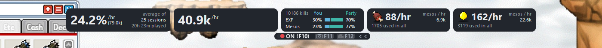

# Classic Handbook

Where to train in **MapleStory Classic World**, for every class and level from 1 to 100, solo or in a party.

**[Open it in your browser](https://nairck.github.io/ClassicHandbook/)**

## Plan

Your class, stats, level and party on the left; the best spots for them on the right, ranked by level, EXP or mesos per hour, and how each one holds up as you level.

The **Party** tab shows what each party size earns you on those maps, by the game's own EXP-sharing rules.

## Maps and monsters

Every hunting map with its layout, portals and the way into hidden maps. Hover a monster for its full card: stats, where it spawns and everything it drops.

## Items

Search any item for its drop odds, who drops it, and its price history from several market sites, with the shops selling it now.

## Quests

Every quest line and event at your level, with its steps, rewards and where to find each item it asks for.

## Live tracker (Windows app, COMING SOON)

Reads your EXP, mesos and potions off the game screen and shows your real rates beside the plan, with an optional overlay on the game.

The same cards can sit right over the game:

## Get it

- **In your browser**: [nairck.github.io/ClassicHandbook](https://nairck.github.io/ClassicHandbook/). Everything except the live tracker and overlay.
- **Windows app** (the exe, with the live tracker and game overlay): **COMING SOON**.

## Good to know

- **Screen reading is off every time the app opens.** When on, it only copies the game window's pixels, like a screenshot: no memory reading and no input to the game. Nexon's terms don't mention screen readers either way, so turning it on is your call.
- **Your data stays on your PC**, in `%LOCALAPPDATA%\ClassicHandbook`. The shared data (game data, prices, drop rates) comes from Classic Handbook's signed data feed on GitHub, so everyone sees the same figures.
- **Sources:** game data from [OSMS Data Explorer](https://osmsdataexplorer.com), drop rates from [osmlib.com](https://osmlib.com) and [MapleStory Quest](https://maplestory.quest), with rates measured in Classic World from [MapleClassic Wiki](https://mapleclassic.wiki)'s kill tests ([CC BY-NC-SA 4.0](https://creativecommons.org/licenses/by-nc-sa/4.0/): the app's drop record built from them shares that licence, for non-commercial use), and prices from public market sites and megaphone trackers (only those whose robots.txt and terms allow reading; [megapn](https://megapn.com) and [GMS Classic Megaphones](https://gmscmegaphone.com) for megaphones (the second cross-checked against the first, each megaphone counted once), [MapleStory Market](https://maplestorymarket.com) for shop listings), each credited in the app.

Unofficial fan tool, not affiliated with Nexon.
